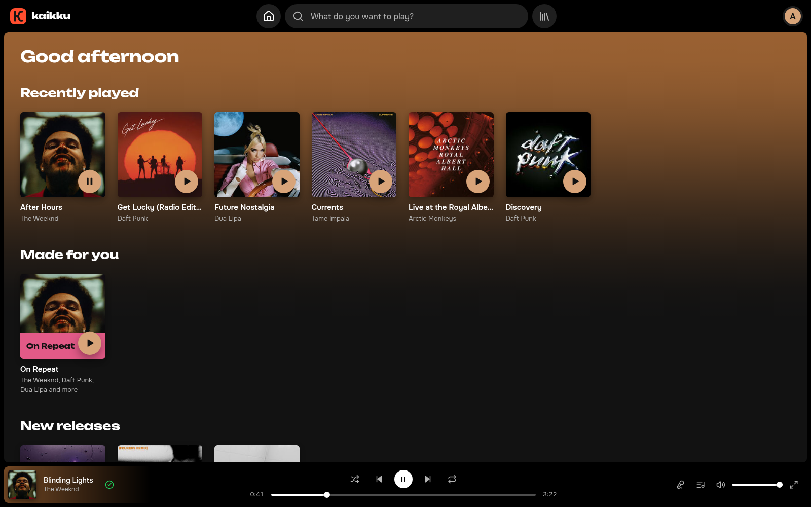
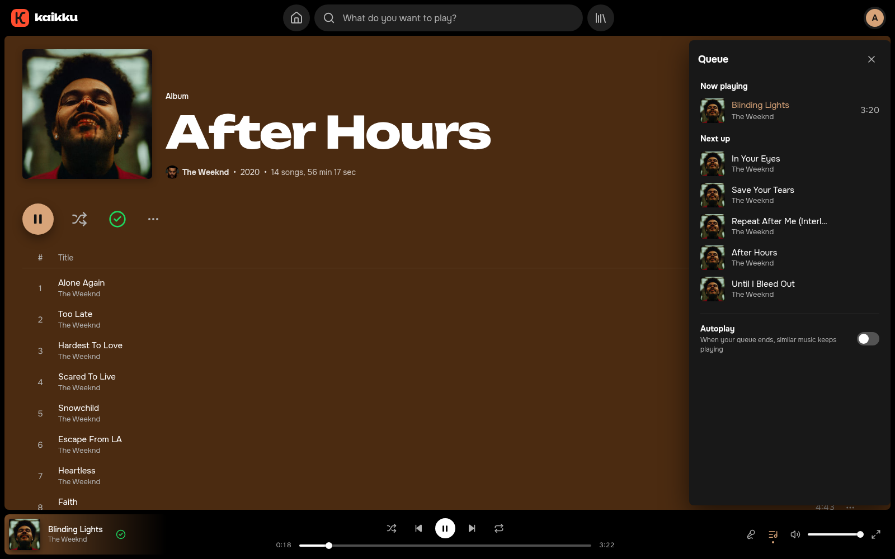
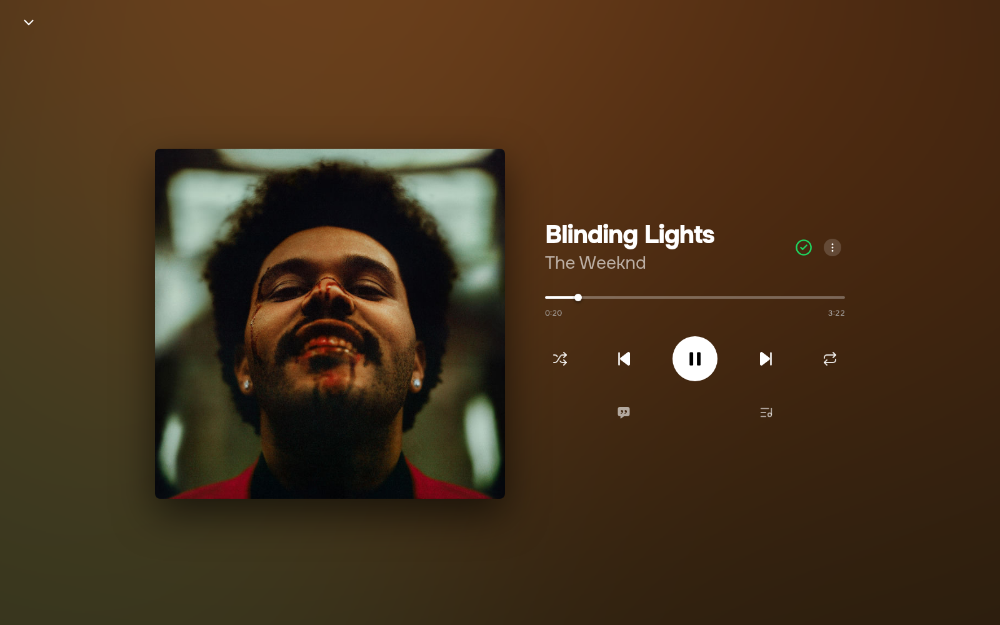
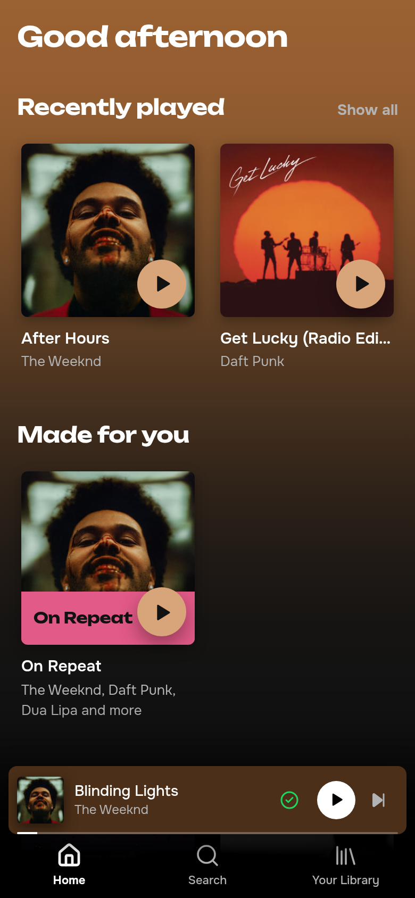

<p align="center">
  
</p>

<h1 align="center">kaikku</h1>

<p align="center">
  Your own music streaming service, on your own server, for you and the people you invite.<br>
  <a href="https://github.com/wkywoff/kaikku/actions/workflows/test.yml"></a>
  <a href="LICENSE"></a>
</p>



kaikku looks and works like the big streaming apps, but runs on your
server. You search a huge catalogue (from Deezer), press play, and the
track starts in a second or two: the audio is found on YouTube and saved to
your server while you listen, so the next time it plays from your disk.
Sign-up is by invite. Listen in the browser, install it on your phone as an
app, or use any Subsonic app.

> **For personal use.** There is no hosted service and no music in this
> repository. Downloading from YouTube may be against the law where you live
> or against YouTube's and Deezer's terms: check first. You are responsible
> for what you download and who you share it with. Don't open your instance
> to the public or charge for it.

## Features

**Listening**
- Any track plays right away, downloaded or not.
- Crossfade (1–12 s) or gapless playback, volume normalisation.
- Queue with drag-and-drop, shuffle, repeat, artist and song radio,
  autoplay of similar music when the queue ends.
- Sleep timer, lock-screen controls and media keys.
- Full-screen player in the cover's colours.

**Lyrics**
- Synced lyrics, word by word where available, with backing vocals; tap a
  line to jump to it.
- From Deezer, LRCLIB and NetEase, no keys needed.

**Library and playlists**
- Liked songs, saved albums, followed artists.
- Playlists with your own cover, public or private; add a whole album or
  artist at once.
- Link previews for albums, artists and public playlists in messengers.

**Discovery**
- Home: recently played, mixes, new releases from artists you follow,
  "You might like", your friends' playlists.
- Mixes made from your listening: On Repeat, Rediscover and genre mixes,
  updated daily.
- Genre pages, search across the catalogue, a year in music in December
  and January.

**Friends**
- Profiles with public playlists. Follow each other to become friends.
- Shared playlists: invite friends to add, remove and reorder songs.

**Your own music**
- Upload your releases (FLAC, WAV, MP3, M4A, OGG and more): tags, covers
  and lyrics are read from the files; a draft is visible only to you and
  the admins until you publish it.

**Apps and integrations**
- Subsonic API: Feishin, Amperfy, Symfonium and other apps.
- Import playlists from a Spotify link, a CSV export or a plain list.
- Last.fm scrobbling (needs a Last.fm API key).

**For the admin**
- Invites and password-reset links.
- Fix anything on top of Deezer's data: titles, dates, covers, artists,
  release types, track order; hide releases, group album versions.
- A "Not found" page for tracks that didn't download, fixed with a YouTube
  link or your own file.

Works on phones (its own layout, gestures, installable as an app) and
desktops, in English and Russian. Not supported: offline listening; on
iPhone, crossfade and volume normalisation.

<p align="center">
  
  
</p>
<p align="center">
  
</p>

## Quick start

You need Docker with Compose v2 and about 2 GB of RAM. Images are built
for amd64 and arm64. Docker is the only supported way to run kaikku.

```bash
git clone https://github.com/wkywoff/kaikku.git && cd kaikku
cp .env.example .env
sed -i "s/^JWT_SECRET=.*/JWT_SECRET=$(openssl rand -hex 32)/; s/^MEDIA_SECRET=.*/MEDIA_SECRET=$(openssl rand -hex 32)/" .env
docker compose up -d
```

Open http://localhost:8080 and create an account: the first one becomes
the admin and needs no invite. Invite everyone else from the account menu.

## Open it to your phone and the internet

- **Home network**: set `HTTP_BIND=0.0.0.0` in `.env` and run
  `docker compose up -d`. The site is then at `http://<server IP>:8080`.
- **Internet, with HTTPS**: put a reverse proxy with a certificate in
  front and set `MEDIA_BASE_URL` to your `https://` address. Phones need
  HTTPS to install the app. With Caddy, which gets the certificate itself:

  ```
  music.example.com {
  	reverse_proxy 127.0.0.1:8080
  }
  ```

  With nginx: `proxy_pass http://127.0.0.1:8080;` with the `Host`,
  `X-Forwarded-For` and `X-Forwarded-Proto` headers, plus
  `client_max_body_size 200m` and `proxy_read_timeout 420s` for uploads.

## Updating, backups, logs

```bash
# Update (database migrations run by themselves)
git pull && docker compose pull && docker compose up -d

# Back up the database, uploaded releases and custom covers into backups/
docker/backup.sh

# Logs
docker compose logs -f api worker
```

`docker/backup.sh` keeps 14 days. Run it nightly, e.g. from cron:
`30 3 * * * /path/to/kaikku/docker/backup.sh /var/backups/kaikku`.
Downloaded audio isn't backed up: it's fetched again when played. How to
restore is at the top of the script.

yt-dlp updates itself every day; YouTube breaks old versions often.

## Optional extras

- **Last.fm**: create an app at
  [last.fm/api/account/create](https://www.last.fm/api/account/create)
  (callback `<your site>/lastfm`) and set `LASTFM_API_KEY` and
  `LASTFM_API_SECRET`. This turns on scrobbling, genres and genre pages,
  genre mixes and artist bios from Last.fm.
- **A second IP for Deezer**: Deezer limits requests per IP. With many
  listeners, set `DEEZER_PROXY` to a SOCKS5 proxy such as Cloudflare WARP.

All settings: [docs/configuration.md](docs/configuration.md).

## Listening in apps

On the site, open **Settings → Apps → Turn on**. It shows the server
address, your username and a separate app password; enter them in any
Subsonic app. What works there: [docs/subsonic.md](docs/subsonic.md).

## Troubleshooting

- **Search or pages fail**: Deezer is down or limiting your IP. Check with
  `curl "https://api.deezer.com/search?q=test"`.
- **A track doesn't download**: see the admin's **Not found** page.
  `match` means no suitable video on YouTube (give a link or a file);
  `download` usually means yt-dlp is outdated:
  `docker compose exec api update-yt-dlp --restart`.
- **Logged out of apps after changing `JWT_SECRET`**: app passwords are
  encrypted with it; create a new one in Settings → Apps.

## Documentation

- [Configuration](docs/configuration.md): every setting.
- [How it works](docs/how-it-works.md): downloads, picking the right
  recording, caching, lyrics.
- [Subsonic apps](docs/subsonic.md): connecting and supported methods.
- [Development](docs/development.md): running locally, tests, layout.

## License

[GPL-3.0](LICENSE). Changed versions you distribute stay under the same
license, with their source. kaikku is not affiliated with Deezer, YouTube,
Spotify or Apple.
